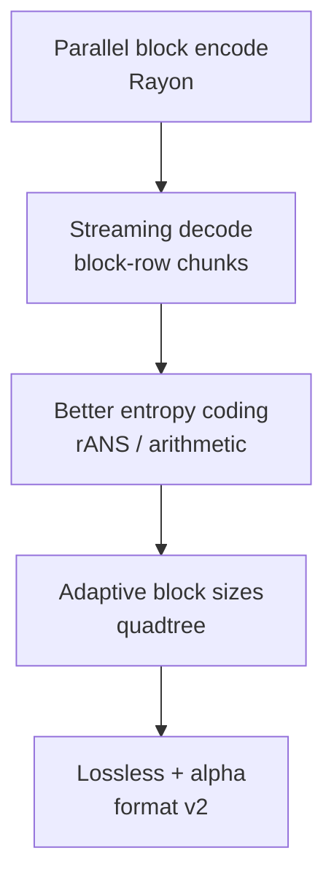

# PIXLZR Architecture (v1 — implemented)

> Scope note: this document describes **what the code in this repository actually
> does**. Earlier revisions described a planned multithreaded, α/β/γ-learned
> density codec with a 60 fps video path; those parts are not implemented and are
> marked as future work (§7). The normative byte layout lives in
> [`format.md`](format.md).

## 1. Pipeline

```mermaid
flowchart LR
    A[RGBA8 input] --> B[Reversible<br/>integer YCoCg]
    B --> C[8x8 block partition<br/>edge-replicated padding]
    C --> D[Density from luma<br/>mean |dx|+|dy|]
    D --> Q[Per-block quant step<br/>step table]
    C --> T[Forward DCT-II<br/>8x8, orthonormal]
    Q --> T
    T --> Z[Quantize + zigzag<br/>i16 coefficients]
    Z --> L[zlib level 6]
    L --> E[.pixlzr v1<br/>header + steps + payload]

    E --> L2[Inflate]
    L2 --> DQ[Dequantize]
    DQ --> ID[Inverse DCT]
    ID --> IC[Inverse YCoCg<br/>+ clamp]
    IC --> O[RGBA8 output<br/>alpha = 255]
```

Everything runs on one thread, end to end. The core crate does no I/O and has no
threading dependency, which is what makes the WASM build a thin re-export rather
than a second implementation.

## 2. Density and quantization

For each padded 8×8 luma block, the encoder sums absolute forward differences to
the right and down, normalises by `64 * 64`, and clamps to `[0, 1]`:

```text
d = clamp( Σ |Δx| + |Δy| / 4096, 0, 1 )

stepY = clamp(round((4 + 28d) * (1.2 - 0.6 * quality/100)), 4, 64)
stepC = clamp(2 * stepY, 4, 64)
```

- A flat block (`d = 0`) at quality 0 gets step 4; the same block at quality 100
  gets step `round(4 * 0.6) = 2 →` clamped to 4 as well, so workable quality is
  bounded by the format floor.
- A fully textured block (`d = 1`) at quality 100 gets `round(32 * 0.6) = 19`;
  lower quality raises it toward 64.
- Chroma always gets a coarser step (`2×`) because the eye is less sensitive to
  chroma detail; the value is clamped to 64.

The chosen `stepY` is written into the file's step table, so the decoder does not
need the original image or the density function. This keeps encode/decode
independent and makes the format inspectable.

**Why this is "density-aware":** the step is a function of local gradient energy,
not a global quality setting. `quality` only scales the whole curve; structure
inside the image decides where bits go. Note the direction: **busier blocks get
larger steps (fewer bits)**, because quantization noise is masked by texture,
while smooth blocks keep finer steps to avoid visible banding.

## 3. Format

```
Offset  Size        Field
0       6           magic "PIXLZR"
6       1           version = 1
7       2           flags = 0
9       4           width  (u32 LE)
13      4           height (u32 LE)
17      1           block size = 8
18      1           quality 0..=100 (informational)
19      4           blocks_x = ceil(width/8)
23      4           blocks_y = ceil(height/8)
27      blocks_x*b_y  per-block quant step, u8, raster order
...     rest        zlib stream of 3*64*i16 zigzag coefficients per block
```

There is no CRC, no entropy coder beyond zlib, and no streaming. A malformed
header is rejected without panicking; a wrong inflated length is rejected as
`Truncated`. See [`format.md`](format.md) for the exact quant rule, zigzag map,
padding and a worked 54-byte example.

## 4. Module layout

```
crates/pixlzr-core/
├── src/
│   ├── lib.rs        public API, PixlzrError, WASM exports, tests
│   ├── format.rs     header parse/write, limits, validation
│   ├── color.rs      RGBA <-> YCoCg
│   ├── dct.rs        orthonormal DCT-II, zigzag
│   ├── encode.rs     block loop, density, quant step, zlib
│   ├── decode.rs     inflate, dequant, IDCT, reconstruct
│   └── bin/pixlzr.rs CLI (feature `cli`)
├── benches/codec.rs  Criterion encode/decode benchmarks
└── Cargo.toml
www/                  vanilla JS demo (wasm-pack `web` target)
```

Public surface:

```rust
pub struct Image { pub width: u32, pub height: u32 }

pub fn encode_rgba(w: u32, h: u32, rgba: &[u8], quality: u8)
    -> Result<Vec<u8>, PixlzrError>;
pub fn decode_rgba(blob: &[u8]) -> Result<(Image, Vec<u8>), PixlzrError>;
pub fn inspect(blob: &[u8]) -> Result<Image, PixlzrError>;
pub fn inspect_header(blob: &[u8]) -> Result<HeaderInfo, PixlzrError>;
```

WASM (`feature = "wasm"`) exposes `encode_rgba`, `decode_rgba`, `image_info`,
`version`; errors become `JsValue` strings.

## 5. Single-thread model

- Encoder: sequential raster loop over blocks. Each block is independent, so a
  future parallel implementation could map blocks and then concatenate in order
  without changing the file format.
- Decoder: same, sequential.
- The WASM build runs on the main thread; no `SharedArrayBuffer`, no workers.

**Not implemented:** Rayon, thread pools, order-preserving parallel collect, or
any multithreaded video path. README and bench docs must not claim otherwise.

## 6. Verification

- Unit tests (in `src/lib.rs`): PSNR > 30 dB and ratio > 2:1 at quality 80 on a
  synthetic gradient; header-only inspection; bad magic/version/flags; truncated
  header and payload; inconsistent block grid; short RGBA buffer; odd sizes.
- CLI round-trip: PNG → `.pixlzr` → PNG, measured PSNR against the source.
- WASM round-trip: `wasm-pack build --target nodejs` + a Node script asserting
  non-empty output, `[w, h]`, and `w*h*4` decoded bytes.
- Criterion: `benches/codec.rs` on a deterministic 512×512 gradient+noise image.

No SSIM, no Butteraugli, no JPEG/PNG/WebP baselines are implemented.

## 7. Future work (not shipped)



Other planned work: measured matched-quality comparisons against standard codecs,
a viewer plugin, and a video filter. None of these are in the current build.

## 8. Performance notes

The benchmark harness exists but no published numbers do. The implementation is
deliberately naïve (direct 2D DCT with a precomputed 8×8 basis, one zlib stream),
so absolute throughput is not the point of v1 — correctness, inspectability and a
real end-to-end demo are. Reproduce locally:

```bash
cargo bench --features bench
# prints timing estimates; no numbers are committed
```
