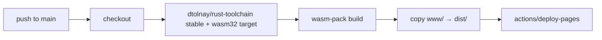

# WASM Live Demo — Spec & Build Plan

> **Status (implemented in v1):** `pixlzr-core` compiles for
> `wasm32-unknown-unknown` with `--features wasm`, `www/src/index.js` drives the
> real codec (`encode_rgba`, `decode_rgba`, `image_info`), and
> `.github/workflows/pages.yml` builds and deploys it. The demo is single-threaded
> and processes one image at a time.
>
> **Still planned (not implemented):** SSIM/perceptual metrics in the UI, the
> comparison slider, a 4096×4096 pre-downscale flow, and multi-image/video
> support. Sections below that describe those remain design notes.

## Goal

`https://guiga-zalu.github.io/pixlzr/` is an interactive proof — drag-drop a
PNG/JPEG → PIXLZR encode → decode in-browser → before/after + ratio + timings.
No clone, no install. Recruiter test ≤30s.

## 1. UX Spec

```
┌─────────────────────────────────────────────────────────┐
│  PIXLZR — Live Demo                                     │
│  Drop an image or [Choose file]   [quality ────────●]   │
├──────────────────────┬──────────────────────────────────┤
│  Original            │  Decoded (PIXLZR)                │
│  <canvas>            │  <canvas>                        │
│  W×H · N KB          │  N KB                            │
├──────────────────────┴──────────────────────────────────┤
│  Stats: Encode X ms · Decode Y ms · N KB -> M KB (R:1)  │
│  Download: [ .pixlzr ] [ restored.png ]                 │
│  Note: WASM single-thread; native is also single-thread │
└─────────────────────────────────────────────────────────┘
```

Requirements:

- Accepts `image/png`, `image/jpeg` (reject others with message).
- Max 16 777 216 pixels (e.g. 4096×4096) — larger files show an error (no downscale yet).
- Shows: original size, compressed size, **ratio**, **encode ms**, **decode ms**. SSIM is **not** computed.
- Before/after panes (a comparison slider is planned, not implemented).
- Download buttons for `.pixlzr` and restored PNG.
- Works on Chrome/Firefox/Safari desktop + mobile (responsive); no `SharedArrayBuffer` required.

## 2. Crate extraction (done)

`pixlzr-core` has no `std::fs`, no CLI deps and no threading, so it compiles
unchanged for `wasm32-unknown-unknown`. Actual layout:

```
crates/pixlzr-core/
├── src/
│   ├── lib.rs        public API, PixlzrError, WASM exports, tests
│   ├── format.rs     header parse/write, limits
│   ├── color.rs      reversible RGBA <-> YCoCg
│   ├── dct.rs        orthonormal 8x8 DCT-II + zigzag
│   ├── encode.rs     density, quant step, block encode
│   ├── decode.rs     inflate, dequant, IDCT, reconstruct
│   └── bin/pixlzr.rs CLI behind the `cli` feature
└── benches/codec.rs  Criterion
```

Actual dependencies:

```toml
[dependencies]
miniz_oxide = "0.8"
wasm-bindgen = { version = "0.2", optional = true }
wee_alloc = { version = "0.4", optional = true }
png = { version = "0.17", optional = true }

[features]
default = []
wasm = ["dep:wasm-bindgen", "dep:wee_alloc"]
bench = []
cli = ["dep:png"]
```

There is no `js-sys`, `web-sys` or `rayon`: the browser decodes the dropped image
and does all DOM work, and the codec is single-threaded in both targets.

## 3. WASM Build Steps

### 3.1 Prerequisites

```bash
rustup target add wasm32-unknown-unknown
cargo install wasm-pack
# or: cargo install trunk  # alternative, see §6
```

### 3.2 Build

```bash
# from repo root
wasm-pack build crates/pixlzr-core --target web --out-dir ../../www/pkg -- --features wasm
# output: www/pkg/pixlzr_core.js  pixlzr_core_bg.wasm  pixlzr_core.d.ts
```

Verify locally:

```bash
python3 -m http.server --directory www 8000
# open http://localhost:8000 — drag-drop should work
```

### 3.3 `www/` glue (minimal)

```
www/
├── index.html
├── pkg/                 # generated by wasm-pack (gitignored, built in CI)
│   ├── pixlzr_core.js
│   ├── pixlzr_core_bg.wasm
│   └── pixlzr_core.d.ts
├── src/
│   ├── index.js         # file input → Uint8Array → wasm encode/decode → canvas
│   └── style.css
└── README.md
```

`www/src/index.js` (actual flow, simplified):

```js
const module = await import("../pkg/pixlzr_core.js"); // dynamic: missing pkg is caught
await module.default();

const bitmap = await createImageBitmap(file);
// draw to a canvas, then read back RGBA pixels
const { width, height, data } = ctx.getImageData(0, 0, bitmap.width, bitmap.height);

const blob = module.encode_rgba(width, height, new Uint8Array(data.buffer), quality);
const restored = module.decode_rgba(blob);
const [decodedWidth, decodedHeight] = module.image_info(blob);
```

WASM exports (`crates/pixlzr-core/src/lib.rs`, `feature = "wasm"`):

```rust
#[wasm_bindgen(js_name = encode_rgba)]
pub fn encode_rgba_wasm(w: u32, h: u32, rgba: &[u8], quality: u8)
    -> Result<Vec<u8>, JsValue>;

#[wasm_bindgen(js_name = decode_rgba)]
pub fn decode_rgba_wasm(blob: &[u8]) -> Result<Vec<u8>, JsValue>; // RGBA bytes

#[wasm_bindgen]
pub fn image_info(blob: &[u8]) -> Result<Vec<u32>, JsValue>;      // [w, h]

#[wasm_bindgen]
pub fn version() -> String;
```

Rust never decodes PNG in WASM; the browser's `createImageBitmap` +
`getImageData` provides RGBA, keeping the module small. Errors are
`PixlzrError` strings converted to `JsValue`, surfaced in `#error` by the page.

## 4. GitHub Pages Deploy

### Option A — `pages.yml` builds WASM (recommended)

File: `.github/workflows/pages.yml` (see repo for full YAML). Flow:



Key steps in the workflow:

```yaml
- uses: dtolnay/rust-toolchain@stable
  with: { targets: wasm32-unknown-unknown }
- run: cargo install wasm-pack
- run: wasm-pack build crates/pixlzr-core --target web --out-dir www/pkg -- --features wasm
- uses: actions/upload-pages-artifact@v3
  with: { path: www }
- uses: actions/deploy-pages@v4
```

Settings → Pages → Source: **GitHub Actions** (not `docs/` branch — Actions source is cleaner for WASM).

### Option B — `docs/` fallback (historical)

The deployed site is built from `www/` by Actions. The old `docs/` branch-source
workflow is no longer needed: `docs/index.html` is now a docs hub, and Pages
stages `docs/*.md` into `www/docs/` so in-app documentation links resolve.

## 5. Verification Checklist

```bash
# local
wasm-pack build crates/pixlzr-core --target web --out-dir www/pkg -- --features wasm
python3 -m http.server --directory www 8000
# → http://localhost:8000 drag-drop PNG → expect encode+decode <500ms for 768×512

# CI dry-run (act or manual dispatch)
gh workflow run pages.yml  # or push to main and watch Actions tab
# → https://guiga-zalu.github.io/pixlzr/ returns 200, drag-drop works

# from pipeline repo that holds this spec
ls www/pkg/pixlzr_core_bg.wasm && echo "wasm ok"
curl -sI https://guiga-zalu.github.io/pixlzr/ | head -1  # expect HTTP/2 200
```

## 6. Alternatives Considered

| Option | Pros | Cons | Verdict |
|--------|------|------|---------|
| `wasm-pack` + `wasm-bindgen` | Rust-native, small glue, works without bundler | manual `www/` wiring | **Chosen** — simplest for demo |
| `trunk` | zero-config `index.html` build, asset pipeline | extra tool, opinionated | Good alt if you want Rust `image` decode in WASM |
| `dioxus`/`leptos` | full Rust frontend | overkill for drag-drop demo | Reject — JS glue is 50 lines |

## 7. Performance Budget

- `pixlzr_core_bg.wasm` target: **<300 KB gzipped** (strip debug, `wasm-opt -Oz` via `wasm-pack --release`).
- Encode 768×512 Kodak: **<400ms** on M1 / **<600ms** on mid-range Android (WASM single-thread).
- If budget exceeded: disable `image` default features in core, use `wee_alloc` (`features = ["wee_alloc"]`).

## 8. Security / Limits

- No network calls from WASM — pure compute.
- Input cap 8MB / 4096×4096 — abort with user-visible error before alloc.
- `encode_rgba` returns `Result<Vec<u8>, JsValue>` — JS shows the error string in `#error`.

---

*Copy this file to `docs/wasm-demo-spec.md` in `pixlzr`. Pair with `.github/workflows/pages.yml` and `www/` from this skeleton.*
